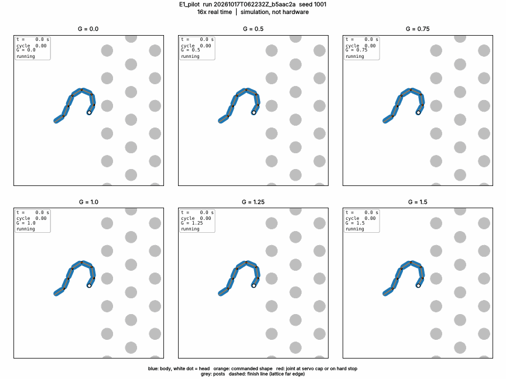
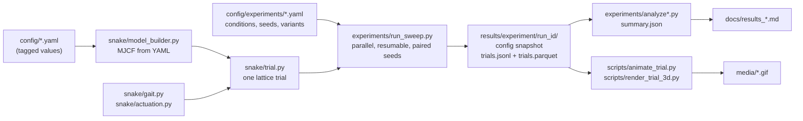
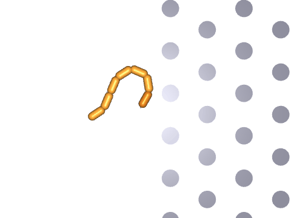

# Compliant cable-driven snake robot: simulation before hardware
[](https://github.com/Anawrulkabir/snakeRobot/actions/workflows/tests.yml)


A MuJoCo simulation of a **planar, bilateral-cable-driven snake robot whose body
compliance can be tuned**. It is used to answer engineering questions *before*
any parts are bought. It follows the "mechanical intelligence" result of
Wang et al. (2023): in a lattice of posts, a robot with intermediate cable
compliance gets through better than a fully stiff or fully loose one.

<p align="center">
  
</p>
<p align="center"><sub>
E1 pilot, medium lattice, seed 1001, replayed from run <code>20261017T062232Z_b5aac2a</code> (16× real time).
Blue: body (white dot = head). Orange: commanded shape. Red: joint at the servo cap or on a hard stop. Grey: posts.
<b>Simulation, not hardware.</b>
</sub></p>

---

## Contents

- [Questions this project answers](#questions-this-project-answers)
- [Status](#status)
- [Results so far](#results-so-far)
- [How the model works](#how-the-model-works)
- [Pipeline](#pipeline)
- [Quick start](#quick-start)
- [Running experiments](#running-experiments)
- [Outputs and reproducibility](#outputs-and-reproducibility)
- [Visualisation](#visualisation)
- [Development workflow](#development-workflow)
- [Repository layout](#repository-layout)
- [Scope and integrity](#scope-and-integrity)
- [Reference work](#reference-work)
- [AI disclosure](#ai-disclosure)

<a href="https://www.youtube.com/watch?v=LZaEG5F0ZEQ">
  
</a>


## Questions this project answers

1. **Does the published effect reproduce in simulation?** Under the same open-loop wave, does an
   intermediate generalized compliance *G* beat a stiff (G = 0) and a loose (G = 1.5) body in a post lattice?
2. **What does the physical robot need?** Joint torque, cable tension, speed and segment length, to choose
   servos (MG90S baseline) and size parts.
3. **Is adaptive slack worth building?** Loosen only when jammed and tighten to push, compared fairly against
   every fixed compliance setting.

The target robot has 7 rigid 3D-printed segments, 6 yaw joints and 0.10 m pitch. Each joint has a
micro servo driving a shared cable spool. An ESP32 and battery sit in the head, and passive wheels sit under
each segment.

## Status

| Milestone | State | Write-up |
|---|---|---|
| Environment, paper notes, model plan (G1, G2) | done | [`paper_notes.md`](docs/paper_notes.md), [`model_plan.md`](docs/model_plan.md) |
| Model builder, gait, wheels; E0 flat ground (G3, G4) | done | [`results_E0.md`](docs/results_E0.md) |
| Compliance implementation A, metrics, tests | done | [`results_M3.md`](docs/results_M3.md) |
| Passive element from paper Fig. 5A | done | [`stiffness_interpretation.md`](docs/stiffness_interpretation.md) |
| E1 pilot (medium lattice, 8 conditions × 20 paired seeds) | done: **floor effect** | [`results_E1_pilot.md`](docs/results_E1_pilot.md) |
| Calibration step 1 (one assumption at a time) | done | [`results_calib_step1.md`](docs/results_calib_step1.md) |
| Calibration step 2 (combined setup, G sweep) | done: **inconclusive** (pre-registered rule) | [`results_calib_step2.md`](docs/results_calib_step2.md) |
| E1 full sweep, implementation B (cable level), E2–E4 | not started | [`CLAUDE.md`](CLAUDE.md) §6 |

Every engineering choice and its reason is logged in [`docs/decisions.md`](docs/decisions.md). Progress notes
are in [`docs/progress.md`](docs/progress.md).

## Results so far

Every number below is copied from a saved run; the run ID is given with it.

**E1 pilot** (run `20261017T062232Z_b5aac2a`): **0/160 successes at every G**, a floor effect.
- 84/160 trials ended by overload. Each time, a post held joint 2 or 3 outside its free range while the
  servo pulled at its cap. No overload came from a hard stop: 84/84 re-runs reproduced exactly with
  diagnostic logging.
- The loose settings never overload; they stall (G = 1.25 and 1.5: 20/20 stuck).

**Calibration step 1** (run `20261017T075321Z_dc2fb6c`, 5 seeds per cell, screening only). Successes out of 5:

| Change from baseline | G = 0 | G = 0.75 | G = 1.5 |
|---|---|---|---|
| baseline | 0 | 0 | 0 |
| body–post friction 0.1 | **4** | 1 | 0 |
| overload rule off (not eligible: a real servo cannot hold stall) | **4** | 2 | 0 |
| amplitude × 0.85 | 2 | 0 | 0 |
| passive stiffness × 4 | 0 | 1 | 0 |
| servo 1.0 N·m (bound, not purchasable) | 1 | 0 | 0 |

The changes that help most help the *stiff* body most. Whether the compliance benefit depends on body–post
friction is logged as an [open question](docs/open_lists.md), not a claim.

**Calibration step 2** (run `20261017T111457Z_cc9bd78`, the pre-registered combination: friction 0.1, 3 s overload
rule, amplitude × 0.85, passive × 4). Successes out of 5 for G = 0, 0.25, 0.5, 0.75, 1.0, 1.25, 1.5: **5, 4, 1, 2, 5,
0, 0**. The pre-registered outcome is **inconclusive**: G = 1.0 ties G = 0 instead of beating both ends by 2. No
setup has been adopted for E1 yet.

> **E1 results will be conditional on calibrated assumptions** (friction, overload rule, amplitude, passive
> stiffness), chosen within plausible ranges. E1 cannot be presented as an independent reproduction of the
> paper's trend.

## How the model works

| Part | Model | Source |
|---|---|---|
| Body | 7 capsules, 6 yaw hinges (±90° stops); planar root (x, y, z slides + yaw hinge, no roll or pitch); per-segment vertical slide | paper geometry, scaled (G4) |
| Ground | one passive wheel per segment; elliptic friction cone; 1.6 : 1 forward/sideways drag | paper ratio; μ is a placeholder |
| Gait | serpenoid wave θᵢ(t) = A sin(ω t − 2π k i / N), a pure function (ESP32-portable) | paper Eq. 2, scaled × 7/6 |
| Compliance (impl. A) | paper Eq. 3 maps (α, G, A) to cable lengths, hence to a free joint range. The joint is passive inside it; a stiff one-sided torque acts at the boundary, capped at the servo stall | paper Eq. 3, S1 |
| Passive element | τ = −c (ζ − α)\|ζ − α\| about the commanded angle α, fitted to Fig. 5A(iii) | digitized figure, friction-scaled |
| Servo | MG90S, 0.2027 N·m stall at 6 V; overload = held at the cap for 1 s | shop listing |
| Lattice | hexagonal posts, d = 0.103 m, L/d = 1.8 / 2.8 / 3.3; body–post μ 0.4 (placeholder) | paper densities |
| Trial end | success (head crosses the far edge), stuck (10 cycles without progress), overload, timeout (40 cycles) | paper p. 37 analogues |
| Primary metric | full-horizon progress rate: displacement ÷ cycles for a success, ÷ 40 cycles otherwise | decision, 2026-10-17 |

All parameters live in tagged YAML (`config/*.yaml`). Each value carries a `source` (paper, hardware, decision,
proposal or placeholder) and a note; nothing is hard-coded.

## Pipeline



## Quick start

Requires Python 3.11+ and [uv](https://docs.astral.sh/uv/). `uv.lock` pins the exact set of packages that
produced the saved runs (Python 3.13).

```bash
git clone https://github.com/Anawrulkabir/snakeRobot.git && cd snakeRobot
uv sync --frozen                         # .venv from uv.lock
uv run pytest                            # full test suite
uv run python scripts/check_env.py       # MuJoCo, headless stepping, viewer, offscreen video
uv run pre-commit install                # ruff lint + format on every commit
```

Without uv: `python3 -m venv .venv && .venv/bin/pip install -r requirements.txt` (exported from the lock).

- **macOS:** the interactive viewer needs MuJoCo's launcher: `mjpython scripts/view_model.py`. Experiments
  are headless and use plain `python`.
- **Video:** mediapy needs `ffmpeg` on the PATH (`brew install ffmpeg`).

## Running experiments

```bash
# A sweep: every condition on the same seeds; resumable after an interruption
uv run python experiments/run_sweep.py config/experiments/E1_pilot.yaml --workers 4
uv run python experiments/run_sweep.py config/experiments/E1_pilot.yaml --resume results/E1_pilot/<run_id>

# Analysis
uv run python experiments/analyze.py results/E1_pilot/<run_id>                 # paired CIs, survival, trial count
uv run python experiments/analyze_calibration.py results/calib_step1/<run_id> \
    --pilot results/E1_pilot/<run_id>                                         # pre-registered step-1 selection
uv run python experiments/analyze_calib_step2.py results/calib_step2/<run_id>  # pre-registered outcome rule
uv run python experiments/diag_pilot_overloads.py results/E1_pilot/<run_id>    # which joint, stop vs post contact

# Passive-element fit from the digitized paper figure
uv run python scripts/stiffness_estimate.py
```

Measured cost: about 0.9 CPU-s per simulated second in the lattice. The pilot (160 trials) took 3.9 CPU-h.

## Outputs and reproducibility

```
results/<experiment>/<run_id>/          run_id = <UTC timestamp>_<git commit>[-dirty]
├── config/              snapshot of every YAML used (a resumed run reuses it)
├── run_info.json        commit, dirty flag, placeholders in use
├── trials.jsonl         raw log, one JSON line per trial (committed)
├── trials.parquet       same rows, typed, verified against the JSONL (committed)
└── summary*.json        analysis outputs cited by the docs (committed)
```

- **Bit-for-bit replays.** `scripts/check_reproduction.py` re-runs logged trials and compares every logged
  field exactly. In the locked environment the pilot baseline reproduces 15/15.
- **Paired design.** A seed fixes the start heading, lateral offset and wave phase for every condition.
- **Divergence is never silent.** NaNs and MuJoCo's own reset on bad accelerations raise. A sweep records a
  diverged trial and the analysis drops that seed from paired comparisons.

## Visualisation

```bash
# 2D top view (matplotlib, no OpenGL): replays a logged trial, checks it against the log, writes a GIF
uv run python scripts/animate_trial.py results/E1_pilot/<run_id> --seed 1001 --G 0.75
uv run python scripts/animate_trial.py results/E1_pilot/<run_id> --seed 1001 --montage 0,0.5,0.75,1.0,1.25,1.5

# 3D overhead (MuJoCo offscreen; on a headless Linux box: apt-get install libosmesa6)
MUJOCO_GL=osmesa PYOPENGL_PLATFORM=osmesa uv run python scripts/render_trial_3d.py \
    results/E1_pilot/<run_id> --seed 1001 --G 0.75 --out media/clip.gif

# Interactive viewer (local machine with a display)
mjpython scripts/view_model.py           # macOS; plain python elsewhere
```

<p align="center">
  
  <br><sub>Overhead MuJoCo render (OSMesa), pilot seed 1001, G = 0.75, 2× real time.</sub>
</p>

## Development workflow

- **Decision gates.** The project owner makes every engineering choice (gates G1–G8 in `CLAUDE.md` §10).
  Options, trade-offs and the choice are logged in `docs/decisions.md`. Outcome rules are pre-registered
  before data exist.
- **Tests that can fail.** Each test is shown to fail on a planted fault: a sign flip, a dropped row, a
  string-typed number, a state nudge.
- **CI.** GitHub Actions runs `ruff check`, `ruff format --check` and `pytest` in the locked environment on
  every push and pull request.
- **Commits.** Formatting-only changes go in their own commits, checked to leave the parsed code unchanged,
  so changes that affect results stay easy to review. Raw results and summaries are committed with each run.
- **Physics checks.** Timestep convergence, energy in a passive coast, penetration and joint-limit
  tolerances (`docs/results_E0.md`, `docs/results_M3.md`).

## Repository layout

```
config/          robot.yaml, gait.yaml, arena.yaml, metrics.yaml, servos.yaml, experiments/*.yaml
snake/           model_builder, actuation (implementation A, passive element), gait, arena, trial, sim,
                 metrics, cable_geometry, config, runlog
experiments/     run_sweep (sweeps), analyze*, diag_* (diagnostics)
scripts/         check_env, check_reproduction, animate_trial, render_trial_3d, stiffness_estimate, view_model, …
tests/           pytest suite
data/            digitized paper figure (Fig. 5A), mass estimate, measured data intake
docs/            paper notes, decisions, progress, results_*.md
results/         one folder per run (raw logs and summaries committed)
media/           GIFs of logged trials
```

## Scope and integrity

- **These are simulation results with an approximate contact model.** Not modelled: cable friction and
  stretch, servo backlash and speed limits, print tolerances, and the physical cause of the passive force
  in Fig. 5A.
- **Every number is traceable.** Docs, plots and this README copy numbers from named fields of saved runs,
  with run IDs.
- **No novelty claims.** Related Goldman-lab work is checked before anything is called an extension
  ([`literature_search.md`](docs/literature_search.md)).
- **Paper material.** The authors' PDFs and figure files are not in this repository. Only values digitized
  from figures (`data/digitized/`) are included.
- **Licence:** none chosen yet.

## Reference work

- T. Wang, C. Pierce, V. Kojouharov, B. Chong, K. Diaz, H. Lu, D. I. Goldman, "Mechanical Intelligence
  Simplifies Control in Terrestrial Limbless Locomotion," *Science Robotics* (2023).
  doi:[10.1126/scirobotics.adi2243](https://doi.org/10.1126/scirobotics.adi2243),
  arXiv:[2304.08652](https://arxiv.org/abs/2304.08652).
- V. Kojouharov, T. Wang, M. Fernandez, J. Maeng, D. I. Goldman, ICRA 2024.
  arXiv:[2309.13532](https://arxiv.org/abs/2309.13532).

## AI disclosure

The code in this repository was written with Claude Code (an AI coding assistant) under the direction of
Fahad, who makes the engineering decisions. [`docs/decisions.md`](docs/decisions.md) records each decision
and his choice. Simulation results are evidence about the model, not about a physical robot.
